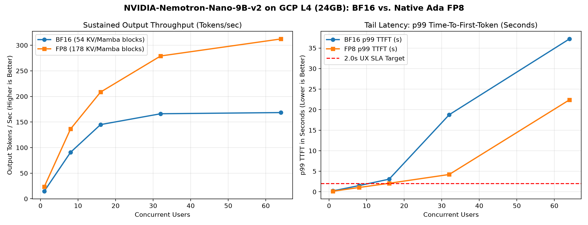

# NVIDIA-Nemotron-Nano-9B-v2 Inference Optimization on GCP L4 (24GB)

End-to-end systems benchmark of `nvidia/NVIDIA-Nemotron-Nano-9B-v2` (27 Mamba-2 + 25 MLP + 4 GQA layers) in **BF16 vs. Native Ada FP8 (`sm_89`)** using **vLLM V1 (`v0.32.0`)** on a single GCP NVIDIA L4 GPU (`23,034 MiB` usable HBM).

## 1. Headline Engineering Gains (BF16 vs. Native Ada FP8)
- **VRAM Weight Compression:** `16.58 GiB` (BF16) -> `9.67 GiB` (FP8), saving **6.91 GiB (-41.7%)**
- **Aligned Mamba/KV Cache Pool (`1,312` tok/block):** `2.94 GiB` (`54` blocks / `70,836` tok) -> `9.73 GiB` (`178` blocks / `234,194` tok) (**3.31x increase**)
- **Single-Stream Decode (`C=1`):** `14.70 tok/s` (`66.90 ms` ITL) -> `23.30 tok/s` (`42.21 ms` ITL) (**+58.5% speedup**)
- **Breaking the 54-Block Queue Wall (`C=32`):** `p99 TTFT` dropped from `18,767 ms` to `4,218 ms` (**-77.5% latency reduction**)
- **Peak Sustained Throughput (`C=64`):** `168.45 tok/s` -> `312.26 tok/s` (**+85.4% throughput**, **$0.249 / 1M tokens** on L4 Spot)



## 2. Phase 1: Silicon Roofline & Hybrid KV Cache Scaling (8x Smaller)
```text
 Seq_Len  Batch  Nemotron_KV_GiB (4 Attn)  Standard_KV_GiB (32 Attn)  Est_Total_VRAM_GiB Fits_on_L4_22.49GiB?
    2048      1                     0.031                       0.25               18.30                  YES
    2048      8                     0.250                       2.00               18.51                  YES
    2048     32                     1.000                       8.00               19.26                  YES
    8192      1                     0.125                       1.00               18.39                  YES
    8192      8                     1.000                       8.00               19.26                  YES
    8192     32                     4.000                      32.00               22.26                  YES
   32768      1                     0.500                       4.00               18.76                  YES
   32768      8                     4.000                      32.00               22.26                  YES
   32768     32                    16.000                     128.00               34.26            OOM CRASH
   65536      1                     1.000                       8.00               19.26                  YES
   65536      8                     8.000                      64.00               26.26            OOM CRASH
   65536     32                    32.000                     256.00               50.26            OOM CRASH
  131072      1                     2.000                      16.00               20.26                  YES
  131072      8                    16.000                     128.00               34.26            OOM CRASH
  131072     32                    64.000                     512.00               82.26            OOM CRASH
```

## 3. Phase 2: Single-Stream Roofline (89.2% HBM Bandwidth) & Thinking Toggle
```text
         Mode        System_Prompt  Output_Tokens  TTFT_ms  ITL_ms_per_tok  Decode_Tok_s      HBM_BW_Used_GB_s  Total_Latency_s
Reasoning OFF            /no_think            350   151.86           66.54         15.03 267.5 / 300.0 (89.2%)            23.38
 Reasoning ON detailed thinking on            350    94.00           66.68         15.00 267.0 / 300.0 (89.0%)            23.36
```

## 4. Phases 3 & 4: Master BF16 vs. FP8 Concurrency Sweep
```text
 Concurrency  BF16_Out_Tok_s  BF16_p99_TTFT_ms  BF16_p50_ITL_ms  BF16_p99_ITL_ms  BF16_Spot_$_1M  FP8_Out_Tok_s  FP8_p99_TTFT_ms  FP8_p50_ITL_ms  FP8_p99_ITL_ms  FP8_Spot_$_1M Throughput_Gain p99_TTFT_Change Cost_Savings
           1           14.70            217.50            66.90            67.75          5.2903          23.30           132.57           42.21           42.74         3.3377           58.5%          -39.0%        36.9%
           8           90.71           1514.86            76.94           226.70          0.8575         136.28          1049.30           50.98          155.63         0.5707           50.2%          -30.7%        33.4%
          16          144.96           3077.61            88.01           582.39          0.5365         208.47          2074.94           61.74          393.96         0.3731           43.8%          -32.6%        30.5%
          32          166.14          18767.16           102.46           583.12          0.4682         279.04          4218.48           84.74          416.06         0.2787           68.0%          -77.5%        40.5%
          64          168.45          37209.43           102.51           579.58          0.4617         312.26         22381.91          123.51          454.78         0.2491           85.4%          -39.8%        46.0%
```

## 5. Phase 5: CUDA Kernel Profile (EngineCore) & Prometheus Telemetry
- `_C::cutlass_scaled_mm` (`sm_89` FP8 GEMM): **69.30% CUDA time** (`1.159s`, `3,328` calls)
- `vllm::mamba_mixer2` (`_selective_scan_update_kernel`): **13.73% CUDA time** (`229.66ms`, `864` calls)
- `FlashAttention-2` (4 GQA layers): **< 0.49% CUDA time**

```text
-------------------------------------------------------  ------------  ------------  ------------  ------------  ------------  ------------  ------------  ------------  ------------  ------------  
                                                   Name    Self CPU %      Self CPU   CPU total %     CPU total  CPU time avg     Self CUDA   Self CUDA %    CUDA total  CUDA time avg    # of Calls  
-------------------------------------------------------  ------------  ------------  ------------  ------------  ------------  ------------  ------------  ------------  ------------  ------------  
                                  _C::cutlass_scaled_mm         5.31%      81.314ms         9.87%     151.083ms      45.397us        1.159s        69.30%        1.159s     348.351us          3328  
void cutlass::Kernel2<enable_sm89_to_sm90<cutlass::g...         0.00%       0.000us         0.00%       0.000us       0.000us     466.434ms        27.88%     466.434ms     289.351us          1612  
void cutlass::Kernel2<enable_sm89_to_sm90<cutlass::g...         0.00%       0.000us         0.00%       0.000us       0.000us     359.563ms        21.50%     359.563ms     429.586us           837  
void cutlass::Kernel2<enable_sm89_to_sm90<cutlass::g...         0.00%       0.000us         0.00%       0.000us       0.000us     286.441ms        17.12%     286.441ms     369.602us           775  
                                     vllm::mamba_mixer2        33.25%     508.736ms        43.50%     665.545ms     770.306us     229.664ms        13.73%     247.111ms     286.009us           864  
                                               aten::mm         1.10%      16.783ms         1.36%      20.845ms      72.377us     213.917ms        12.79%     213.917ms     742.767us           288  
                          _selective_scan_update_kernel         0.00%       0.000us         0.00%       0.000us       0.000us     208.408ms        12.46%     208.408ms     248.994us           837  
void cutlass::Kernel2<cutlass_80_wmma_tensorop_bf16_...         0.00%       0.000us         0.00%       0.000us       0.000us     172.710ms        10.32%     172.710ms       1.107ms           156  
void cutlass::Kernel2<enable_sm89_to_sm90<cutlass::g...         0.00%       0.000us         0.00%       0.000us       0.000us      46.872ms         2.80%      46.872ms     450.694us           104  
void cutlass::Kernel2<cutlass_80_wmma_tensorop_bf16_...         0.00%       0.000us         0.00%       0.000us       0.000us      39.029ms         2.33%      39.029ms     314.751us           124  
                                            aten::copy_         2.12%      32.424ms         4.20%      64.197ms      23.370us      10.134ms         0.61%      10.136ms       3.690us          2747  
                                              aten::mul         2.15%      32.940ms         3.46%      52.952ms      20.429us       9.705ms         0.58%       9.705ms       3.744us          2592  
                                            aten::index         0.26%       3.972ms         0.52%       7.919ms      64.384us       8.926ms         0.53%       8.982ms      73.026us           123  
                              _state_passing_fwd_kernel         0.00%       0.000us         0.00%       0.000us       0.000us       8.884ms         0.53%       8.884ms     329.024us            27  
                            _C::static_scaled_fp8_quant         2.51%      38.442ms         5.26%      80.520ms      24.195us       8.821ms         0.53%       8.823ms       2.651us          3328  
void vllm::scaled_fp8_quant_kernel_strided_group_sha...         0.00%       0.000us         0.00%       0.000us       0.000us       8.821ms         0.53%       8.821ms       2.651us          3328  
void at::native::vectorized_gather_kernel<16, long>(...         0.00%       0.000us         0.00%       0.000us       0.000us       8.702ms         0.52%       8.702ms     145.036us            60  
                                 aten::_index_put_impl_         0.04%     573.579us         0.12%       1.788ms      66.223us       8.174ms         0.49%       8.252ms     305.644us            27  
-------------------------------------------------------  ------------  ------------  ------------  ------------  ------------  ------------  ------------  ------------  ------------  ------------  
Self CPU time total: 1.530s
Self CUDA time total: 1.673s
```

### Production Prometheus Metrics (`/metrics`)
```text
vllm:kv_cache_usage_perc{engine="0",model_name="nvidia/NVIDIA-Nemotron-Nano-9B-v2-FP8"} 0.0
vllm:num_preemptions_total{engine="0",model_name="nvidia/NVIDIA-Nemotron-Nano-9B-v2-FP8"} 0.0
vllm:num_preemptions_created{engine="0",model_name="nvidia/NVIDIA-Nemotron-Nano-9B-v2-FP8"} 1.7930186528830473e+09
vllm:prompt_tokens_total{engine="0",model_name="nvidia/NVIDIA-Nemotron-Nano-9B-v2-FP8"} 134144.0
vllm:generation_tokens_total{engine="0",model_name="nvidia/NVIDIA-Nemotron-Nano-9B-v2-FP8"} 33536.0
vllm:time_to_first_token_seconds_sum{engine="0",model_name="nvidia/NVIDIA-Nemotron-Nano-9B-v2-FP8"} 649.5869083404541
vllm:inter_token_latency_seconds_sum{engine="0",model_name="nvidia/NVIDIA-Nemotron-Nano-9B-v2-FP8"} 3835.7567032769475
vllm:e2e_request_latency_seconds_count{engine="0",model_name="nvidia/NVIDIA-Nemotron-Nano-9B-v2-FP8"} 262.0
```
